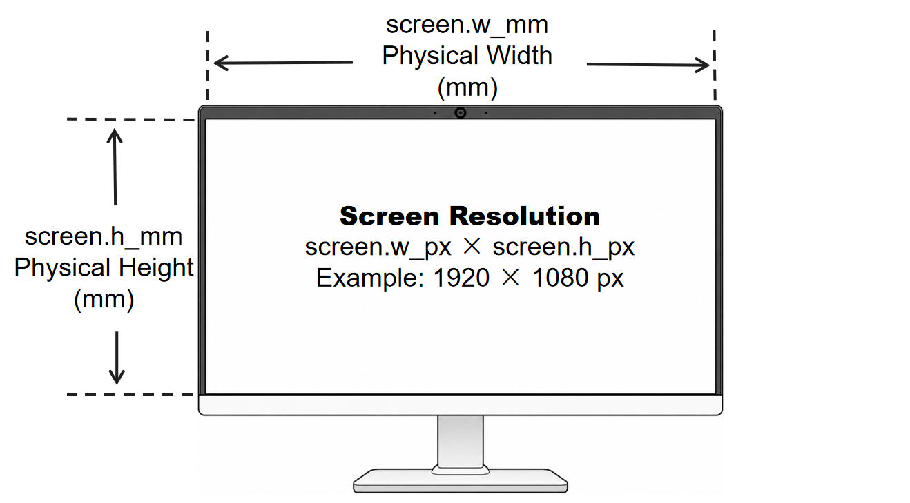
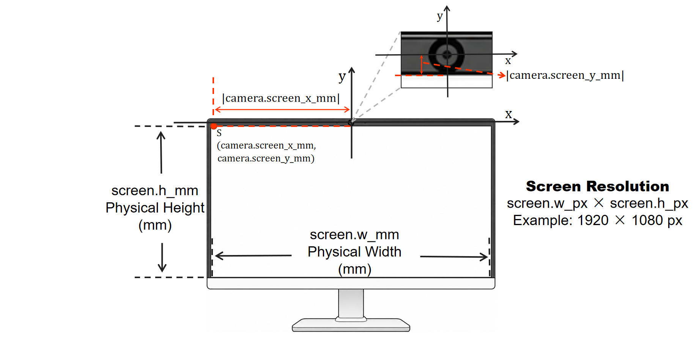

# SeetaPsych Gaze Screen

> SeetaPsych 屏幕注视估计模块集合。

简体中文 | [English](README.md)

[](pyproject.toml)
[](LICENSE)

## 使用说明

本项目已包含在 seetapsych-lib 的默认配置中。通过 `seetapsych-manager download` 即可下载并使用。

具体用法参见 [SeetaPsych](https://github.com/seetapsych/seetapsych-lib)。

注视估计算法依赖 `open-gaze-estimation`，请从 GitHub 单独安装：

```bash
uv pip install git+https://github.com/Elorfiniel/open-gaze-estimation-2025-release.git
```

也可通过以下方式额外加载本算法模块。

### WebUI

运行 `seetapsych-webui` 时使用 `--files` 参数加载：

```
seetapsych-webui --files \
  seetapsych_gaze_screen/modules/affnet.yml \
  seetapsych_gaze_screen/modules/tdgazenet.yml
```

### 编程使用

在程序中添加以下代码以使用本算法模块：

```python
from seetapsych_lib.runtime.factory import Factory
from seetapsych_lib.runtime.pipeline import Pipeline

factory = Factory()
factory.load_file_modules("seetapsych_gaze_screen/modules/affnet.yml")

pipeline = Pipeline(factory, ...)

pipeline.add_attributes("face/gaze_screen")
```

完整的端到端示例（含可视化）参见：

* [examples/camera_gaze_screen.py](examples/camera_gaze_screen.py) — 实时摄像头屏幕注视估计，在屏幕平面上绘制注视点。

### 模块目录

| 模块 YAML | 算法包名称 |
|---|---|
| `affnet.yml` | GazeScreen-AFFNet(OpenGaze) |
| `tdgazenet.yml` | GazeScreen-TDGazeNet(OpenGaze) |

### GazeScreen-AFFNet(OpenGaze)

> 开源注视估计工具包，从人脸关键点或网格计算屏幕注视坐标。

模块配置：[affnet.yml](seetapsych_gaze_screen/modules/affnet.yml)

| 算法包 | 提供 | 依赖 |
|---|---|---|
| GazeScreen-AFFNet(OpenGaze) | `face/gaze_screen` | `face/mesh` |

**说明**

使用 AFFNet[^1] 估计屏幕注视坐标，模型预测双眼共享的单一注视位置。适用于单用户桌面场景，精度与计算成本适中。

**参数**

| 名称 | 类型 | 默认值 | 说明 |
|---|---|---|---|
| `data` | object | *(见下方)* | 摄像头/屏幕标定与图像预处理设置。字段详情见 [`data` 参数参考](#data-参数参考)。 |

**模型**

| 模型 | 版本 | 推荐 |
|---|---|---|
| `opengaze-affnet-v2.safetensors` | 2.0 | ✓ |
| `opengaze-affnet.safetensors` | 1.0 |  |

**输出属性**
- `face/gaze_screen` — [规格](https://github.com/seetapsych/seetapsych-attributes#facegaze_screen)。

### GazeScreen-TDGazeNet(OpenGaze)

> 开源注视估计工具包，从人脸关键点或网格计算屏幕注视坐标。

模块配置：[tdgazenet.yml](seetapsych_gaze_screen/modules/tdgazenet.yml)

| 算法包 | 提供 | 依赖 |
|---|---|---|
| GazeScreen-TDGazeNet(OpenGaze) | `face/gaze_screen` | `face/mesh` |

**说明**

基于 TdGazeNet 的高精度注视估计，引入 3D 人脸先验、相机内参与多任务头部分支；输出左眼与右眼各自独立的注视向量。在 OpenGaze 各变体中精度最高，但计算开销更大。

**参数**

| 名称 | 类型 | 默认值 | 说明 |
|---|---|---|---|
| `optimize` | selection | `none` | 主干网络加载后的结构优化。设为 `reparameterize` 可将 BatchNorm 折叠进卷积层以加快推理，但会增加加载耗时；在必须保留精确权重的训练或调试流程中使用 `none`。可选值：`none`、`reparameterize`。 |
| `data` | object | *(见下方)* | 摄像头/屏幕标定与图像预处理设置。字段详情见 [`data` 参数参考](#data-参数参考)。 |

**模型**

| 模型 | 推荐 |
|---|---|
| `opengeze-tdgazenet.safetensors` | ✓ |

**输出属性**
- `face/gaze_screen` — [规格](https://github.com/seetapsych/seetapsych-attributes#facegaze_screen)。

## `data` 参数参考

所有注视屏幕模块在 `data` 参数下共享相同的顶层结构。根据算法是否依赖 **3D 人脸先验**，分为两种布局。屏幕尺寸（`w_px`、`h_px`、`w_mm`、`h_mm`）在两种布局中通用；摄像头部分字段不同。

### 通用字段（screen 段落）

屏幕物理尺寸与像素分辨率用于在相机坐标系（毫米）与屏幕坐标系（像素）之间进行换算。取值必须与实验中实际使用的显示器一致。

| 字段 | 类型 | 示例 | 说明 |
|---|---|---|---|
| `screen.w_px` | int   | `1920` | 屏幕宽度（像素，即水平分辨率）。 |
| `screen.h_px` | int   | `1080` | 屏幕高度（像素，即垂直分辨率）。 |
| `screen.w_mm` | float | `310` | 屏幕物理宽度（毫米，在显示有效区域上测量）。 |
| `screen.h_mm` | float | `174` | 屏幕物理高度（毫米）。 |

<div align="center" id="figure-resolution">
  
  <p><em><strong>图 1</strong> 屏幕物理尺寸与分辨率 — 布局 A 与布局 B 通用。图中标出了 <code>screen.w_mm</code>（显示区域有效宽度，单位 mm）、<code>screen.h_mm</code>（显示区域有效高度，单位 mm）的测量位置，以及 <code>screen.w_px × screen.h_px</code>（例如 1920 × 1080 px）与物理面积的对应关系。这四个值决定了将注视点投影为屏幕坐标时的 mm↔像素换算系数；取值错误会使估计的注视点产生成比例的缩放偏移。对于 TDGazeNet（布局 B），精确的屏幕尺寸尤为关键，因为 3D 人脸先验的投影依赖于带度量单位的屏幕平面与注视射线求交。</em></p>
</div>

### 布局 A — 简易相机偏移（AFFNet）

用于直接在相机坐标系中估计注视、再根据已知相对位置投影到屏幕平面的算法。不进行逐像素镜头畸变校正；若你的相机存在较强畸变，请先对帧做去畸变再送入流水线。

```json
{
  "camera": {
    "screen_x_mm": -155,
    "screen_y_mm": -5
  },
  "screen": {
    "h_px": 1080,
    "w_px": 1920,
    "h_mm": 174,
    "w_mm": 310
  }
}
```

| 字段 | 类型 | 默认值 | 说明 |
|---|---|---|---|
| `camera.screen_x_mm` | float | `-155` | 相机光学中心到屏幕原点（显示区域左上角）的水平偏移，**沿相机 X 轴，单位毫米**。符号约定：**右 = 正，左 = 负**。典型笔记本摄像头位于屏幕中心上方，因而屏幕在相机左侧，该值通常为负。 |
| `camera.screen_y_mm` | float | `-5` | 相机光学中心到屏幕原点的垂直偏移，**沿相机 Y 轴，单位毫米**。符号约定：**上 = 正，下 = 负**。摄像头安装在屏幕上边框时，屏幕略低于相机，因而该值通常略负或接近零。 |

<div align="center" id="figure-layout-a">
  
  <p><em><strong>图 2</strong> 布局 A — 相机–屏幕几何关系。图示 <code>camera.screen_x_mm</code> 与 <code>camera.screen_y_mm</code> 如何度量从相机光学中心到屏幕原点 <em>S</em>（显示区域左上角）的带符号偏移，以及用于 mm↔px 换算的屏幕物理尺寸 <code>screen.w_mm</code>/<code>screen.h_mm</code> 与像素分辨率。在为 AFFNet 配置进行物理测量时，可将本图作为视觉参考。</em></p>
</div>

### 布局 B — 完整相机标定（TDGazeNet）

用于利用 3D 人脸先验的算法。相机内参与 OpenCV 格式的畸变系数用于图像/关键点去畸变与几何归一化；屏幕到相机的外参变换用于将预测出的 3D 注视射线投影到屏幕平面。

通过标准相机标定流程（如 OpenCV / Matlab 棋盘格标定）获取 `camera.intrinsic` 与 `camera.distortion`。对于 `camera.extrinsic`，保持旋转矩阵不变，仅根据实际相机–屏幕几何关系估计或测量平移向量 `t`，详见下文。

```json
{
  "camera": {
    "intrinsic": [
      [972.01, 0.0, 652.68],
      [0.0, 972.35, 373.91],
      [0.0, 0.0, 1.0]
    ],
    "extrinsic": [
      [-1.0, 0.0, 0.0, 155.0],
      [0.0, 1.0, 0.0, 5.0],
      [0.0, 0.0, -1.0, 2.5]
    ],
    "distortion": [0.123508, -0.334222, -0.002206, 0.000207, 0.199979]
  },
  "screen": {
    "h_px": 1080,
    "w_px": 1920,
    "h_mm": 174,
    "w_mm": 310
  }
}
```

| 字段 | 类型 | 维度 | 说明 |
|---|---|---|---|
| `camera.intrinsic` | `list[list[float]]` | 3 × 3 | 针孔相机内参矩阵 `[[fx, 0, cx], [0, fy, cy], [0, 0, 1]]`。`fx`、`fy` 为以像素为单位的焦距；`cx`、`cy` 为主点像素坐标。 |
| `camera.distortion` | `list[float]` | 5 | OpenCV 5 参数畸变系数 `[k1, k2, p1, p2, k3]`，顺序为常规的径向 + 切向。对接近无畸变的镜头（如出厂校准的工业相机）可全部置零。 |
| `camera.extrinsic` | `list[list[float]]` | 3 × 4 | 屏幕到相机的刚体变换 `[R \| t]`，按行优先排列。3×3 的 `R` 将屏幕坐标轴旋转至相机坐标系；3×1 的 `t` 为屏幕原点（显示区域左上角）在相机坐标系下的位置，单位 mm。默认的 `R = diag(-1, 1, -1)` 匹配标准的「摄像头位于屏幕前方」安装方式。符号约定与测量指南见下方 [`data.camera.extrinsic`](#datacameraextrinsic)。 |

### `data.camera.extrinsic`

相机外参矩阵。在当前实现中，**仅需根据实际相机–屏幕布置调整平移向量** $t = [t_x, t_y, t_z]^T$（即矩阵的最后一列）。其余条目保持不变。

平移向量 $t$ 给出**显示区域左上角**在相机坐标系中的位置，单位为毫米。

相机坐标系以**相机光学中心**为原点：

- **+X** 指向相机图像的右方（即用户面对显示器时指向用户的左侧）。
- **+Y** 指向下方。
- **+Z** 沿相机光轴向前，从相机指向用户。

沿上述坐标轴，分别测量相机光学中心到显示区域左上角的带符号偏移，即得 $t_x$、$t_y$、$t_z$。

**示例**。若相机光学中心与 310 mm 宽显示区域的中心水平对齐，则左上角在 +X 方向约 155 mm 处，故 $t_x \approx 155\,\mathrm{mm}$。若显示区域上边缘位于相机光学中心下方 5 mm，则 $t_y \approx 5\,\mathrm{mm}$。若显示平面位于相机光学中心沿 +Z 方向 2.5 mm 处，则 $t_z \approx 2.5\,\mathrm{mm}$。

因此，

$$
t \approx [155,\; 5,\; 2.5]^T\ \mathrm{mm}.
$$

## 参考文献

[^1]: Yiwei Bao, Yihua Cheng, Yunfei Liu, and Feng Lu. "Adaptive Feature Fusion Network for Gaze Tracking in Mobile Tablets." In *International Conference on Pattern Recognition (ICPR)*, 2020.
